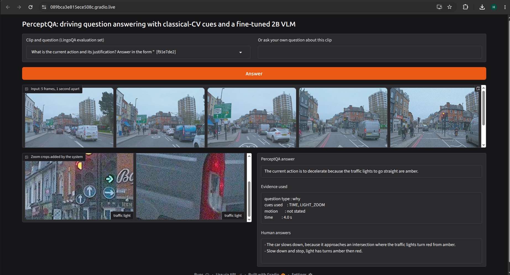
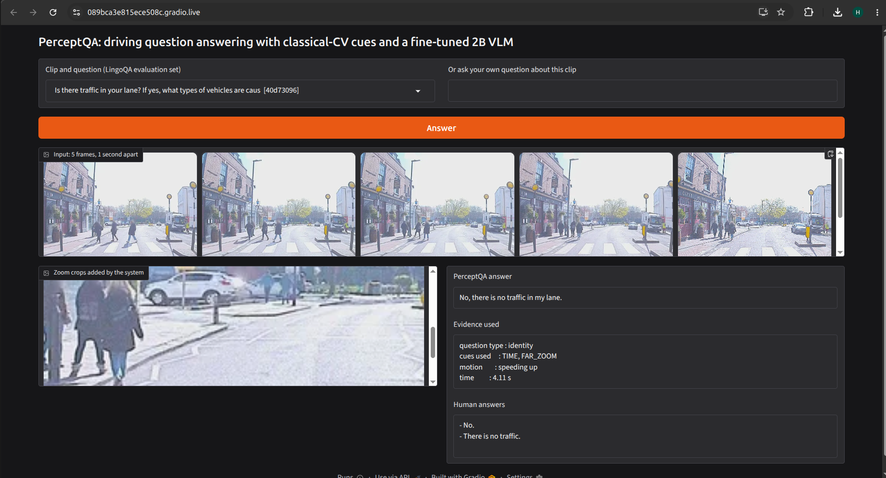

# PerceptQA

**Driving video question answering with a 2B vision-language model and classical computer-vision cues.**

Instead of scaling up the model, PerceptQA gives a small VLM what it cannot see well on its own: how the car is moving, where the traffic lights are, and what lies far down the road. All of it is computed with classical OpenCV geometry; there is no object detector or depth network. The whole system is trained and served on a single free T4 GPU.

<p align="center"></p>

## Pipeline

```
5 dashcam frames (1 s apart) + question
        │
        ├─ Question router ───── 12 question types → which cues this question needs
        ├─ CV cue extractors ─── ego motion   SIFT + essential matrix + road flow → "your car is slowing down"
        │                        traffic light HSV colour + roundness + persistence → zoom crops
        │                        road ahead    focus of expansion / lane vanishing point → zoom crop
        │                        timestamps    t = -4 s … t = 0 s
        ├─ Prompt builder ────── motion sentence in the system prompt, crops as extra images
        └─ Qwen3.5-2B (4-bit) + LoRA, fine-tuned with cue dropout ──► answer + evidence trace
```

## Results

LingoQA official evaluation set (500 questions), scored with the official **Lingo-Judge**.

In the LingoQA paper, the authors' own model (Vicuna-1.5-7B, fine-tuned on LingoQA with 5 frames) scores **60.8** on Lingo-Judge, and GPT-4V scores **59.6**. PerceptQA reaches **62.4** with a model roughly 3.5× smaller.

| Model | Size | Lingo-Judge |
|---|---|---|
| GPT-4V, zero-shot ¹ | — | 59.6 |
| LLaVA, fine-tuned on LingoQA ¹ | 7B | 59.0 |
| LingoQA authors' model, Vicuna-1.5-7B fine-tuned ¹ | 7B | 60.8 |
| **PerceptQA** (Qwen3.5-2B, 4-bit, LoRA + CV cues) | **2B** | **62.4** |

¹ As reported in the LingoQA paper ([Marcu et al., ECCV 2024](https://arxiv.org/abs/2312.14115)).

- Data: a subset of LingoQA, made up of the full official evaluation set (500 questions), the full scenery set (3,508 clips) and 12,000 of the ~24.5K action clips, with 1,000 action clips held out. Training uses one question per clip, balanced across question types: **14,508** examples.
- Ego-motion from 5 frames at 1 fps, without a learned detector: **85%** balanced accuracy (stopped vs moving, slowing vs speeding up).
- Cues computed for **15,108** clips in **3.9 h** on a 4-core CPU. LoRA fine-tuning on **14,508** examples in **~8 h** on one T4.

## Demo

| | |
|---|---|
|  |  |

Raw screenshots go in `assets/screenshots/`; `python assets/prepare_screenshots.py` writes the trimmed versions to `assets/demo/`.

## Repository

```
perceptqa/     library: router, cues/, prompt, model, judge, pipeline
scripts/       01 model selection · 02 cue maker · 03 fine-tuning · 04 evaluation · 05 demo app
notebooks/     the Kaggle notebooks that produced the results, with outputs
outputs/       cue files, predictions, scores and logs
docs/          project guide: how every cue is built, fed and trained
```

```python
from perceptqa import PerceptQA
qa = PerceptQA(adapter="lora_cues", ego_model_path="models/ego_model.joblib")
qa("lingoqa/evaluation/<clip_id>", "Should you stop or brake in this situation?")["answer"]
```

Data: [LingoQA](https://github.com/wayveai/LingoQA) · Judge: [Lingo-Judge](https://huggingface.co/wayveai/Lingo-Judge) · Base model: Qwen3.5-2B · Fine-tuning: [Unsloth](https://github.com/unslothai/unsloth)
